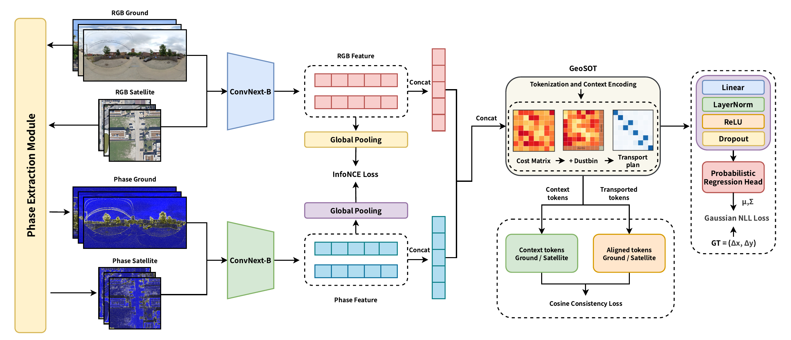

# GeoSOT: Geometry-Aware Cross-View Geo-Localization via Phase Priors and Spatial Optimal Transport

This repository contains the official PyTorch implementation for the paper: **"GeoSOT: Geometry-Aware Cross-View Geo-Localization via Phase Priors and Spatial Optimal Transport"**.

## Abstract

Ground-to-satellite geo-localization requires matching images despite large changes in viewpoint and appearance. A global similarity score can rank satellite references without identifying which regions support a match. GeoSOT uses phase-guided local correspondences to learn retrieval representations and support probabilistic localization. It computes regional matching costs from RGB appearance and structural cues from Fourier phase, then uses differentiable spatial optimal transport to align regions jointly, with a learnable dustbin for unmatched content. The resulting alignments guide retrieval training without annotated patch matches. On VIGOR, the same matching mechanism also supports localization: GeoSOT combines contextual and aligned features to predict a Gaussian offset distribution for each shortlisted reference. The predicted mean estimates the query position within the reference, and the covariance guides reranking. GeoSOT uses global descriptors alone for retrieval on CVUSA and CVACT, reaching 98.92% R@1 on CVUSA. On VIGOR, reranking the same ten candidates per query raises R@1 from 80.96% to 82.39% on Same-Area and from 66.34% to 68.30% on Cross-Area.

## Architecture



---

## 🛠️ Installation & Requirements

Ensure you have Python 3.10+ installed. The required packages can be installed via:

```bash
pip install -r requirements.txt
```

Key dependencies:

- `torch >= 1.13.1`
- `timm >= 0.8.8`
- `scipy >= 1.10.0`
- `albumentations >= 1.3.0`
- `transformers >= 4.27.0`

---

## 📂 Dataset Preparation

1. **Download Datasets:**
Download CVUSA, CVACT, and VIGOR datasets and organize them into the `data` directory according to the following structure:

```text
├─ GeoSOT
  ├── pretrained/     # Place pretrained weights here
  ├── data/
    ├── VIGOR/ 
    ├── CVUSA/ 
    └── CVACT/
  └── geosot/     # Core library components
```

1. **Distance Pre-computation:**
Before training, pre-compute the GPS-based distances using the provided scripts:

```bash
python calc_distance_cvusa.py
python calc_distance_cvact.py
python calc_distance_vigor.py
```

---

## 🚀 Training

To train the GeoSOT models from scratch, execute the corresponding training scripts. The dual-stream encoders are initialized with ImageNet-pretrained ConvNeXt-B weights.

### CVUSA

```bash
python train_cvusa.py
```

### CVACT

```bash
python train_cvact.py
```

### VIGOR (Same-Area and Cross-Area)

```bash
python train_vigor.py
```

---

## 📊 Evaluation

We provide dedicated evaluation scripts to evaluate models on respective datasets and splits. Ensure your model weights are in the appropriate save directory before running.

### CVUSA Evaluation

```bash
python eval_cvusa.py
```

### CVACT Evaluation

```bash
python eval_cvact.py
```

### VIGOR Evaluation

Evaluate on the Same-Area and Cross-Area splits separately:

```bash
python eval_vigor_same.py
python eval_vigor_cross.py
```

*Note: Evaluation includes coarse global retrieval and the uncertainty-guided geometric re-ranking phase.

---

## Acknowledgments

This repository builds upon the foundational code of Sample4Geo and incorporates advanced spatial optimal transport matching techniques for cross-view tasks.
